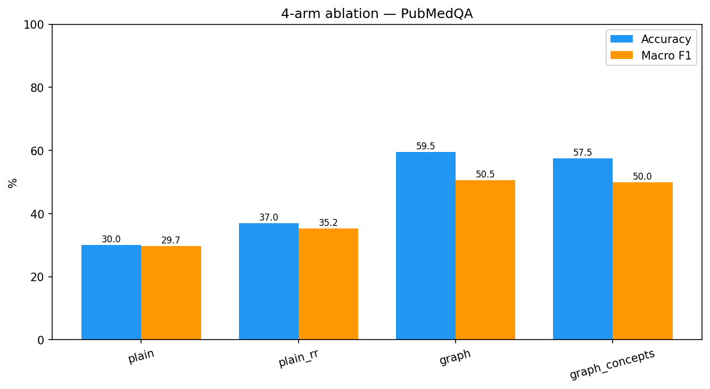
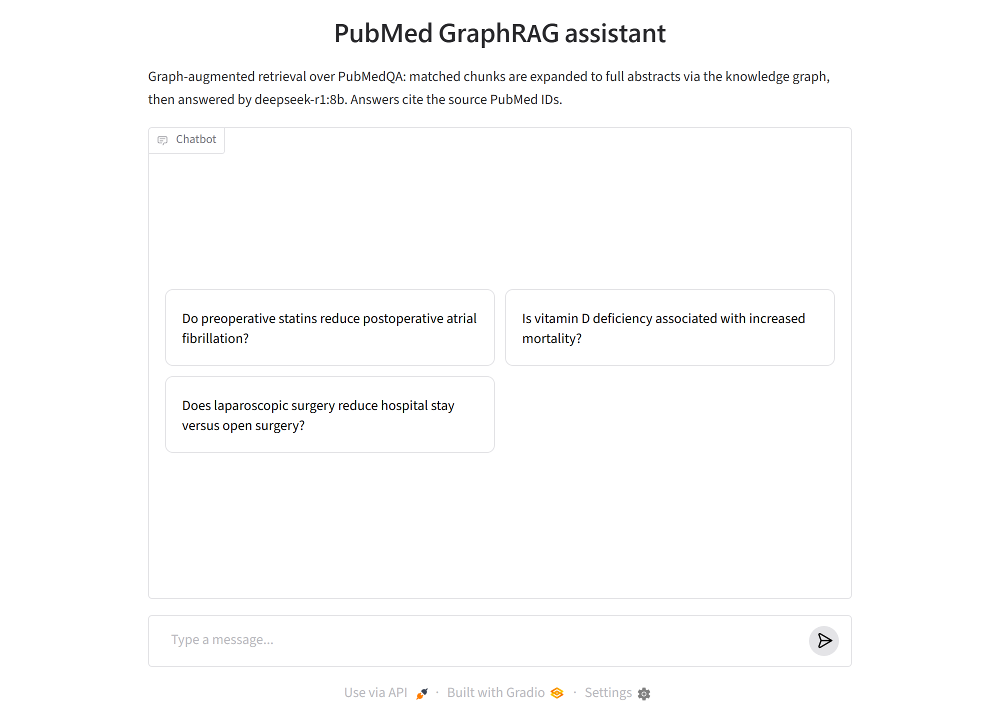
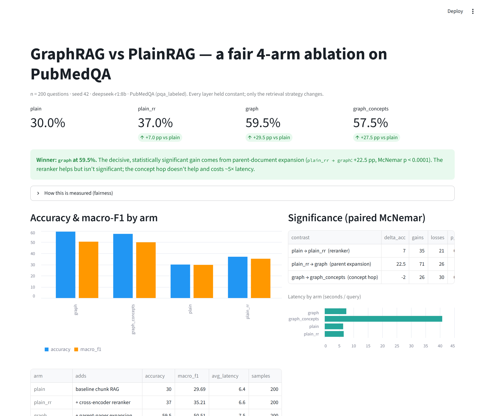
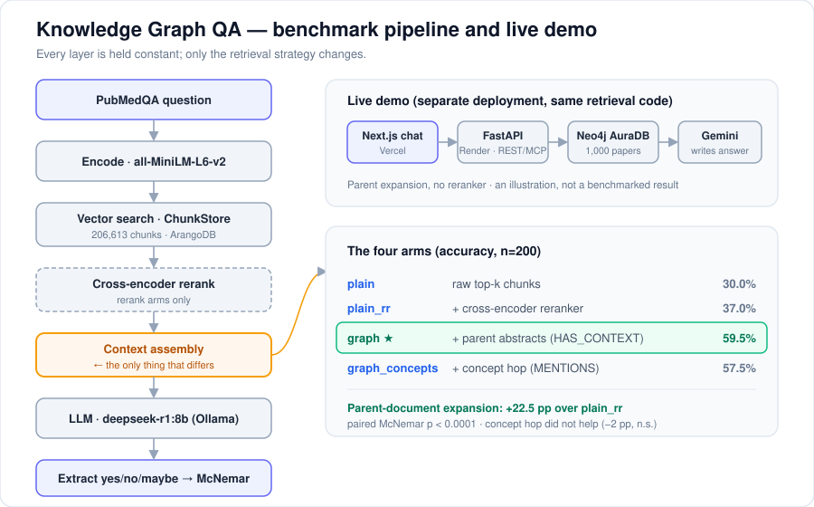

<div align="center">

# 🧬 Knowledge Graph Question Answering

### Does a knowledge graph actually make AI question answering better? A fair, measured test on medical research papers.

[](https://github.com/vardhjain/graphrag-pubmedqa-ablation/actions/workflows/ci.yml)
[](https://codecov.io/gh/vardhjain/graphrag-pubmedqa-ablation)
[](https://www.python.org/)
[](LICENSE)
[](https://github.com/astral-sh/ruff)
[](https://graphrag-pubmedqa-ablation.vercel.app)
[](https://graphrag-pubmedapp-ablation-busqcyjfc7kywhq9m9flwo.streamlit.app)
[](https://vardhjain.github.io/graphrag-pubmedqa-ablation/)

[**▶ Live demo**](https://graphrag-pubmedqa-ablation.vercel.app) &nbsp;·&nbsp; [**Results**](#-results) &nbsp;·&nbsp; [**How it works**](#-how-the-experiment-works) &nbsp;·&nbsp; [**Run it yourself**](#-run-it-yourself) &nbsp;·&nbsp; [**Results dashboard**](https://graphrag-pubmedapp-ablation-busqcyjfc7kywhq9m9flwo.streamlit.app)

Co-built with [Akash Raghavendra](https://github.com/Akash-Raghavendra).

</div>

## 👋 The short version

AI assistants answer questions more reliably when they first look up relevant
documents and read them before answering (this is called *retrieval-augmented
generation*, or **RAG**). A popular upgrade is **GraphRAG**: store the documents
in a *knowledge graph* that records how pieces of text relate to each other, and
use those links to find better context.

Many demos claim GraphRAG beats plain RAG, but the comparisons are often
unfair: the graph version quietly gets extra help, or the correct answer leaks
into what the AI reads. This project removes those advantages and asks a
narrower question: **when everything else is held equal, which part of the
graph actually helps?**

**What we found**, on 200 yes/no/maybe questions about medical research papers:

- **Giving the AI the whole paper summary instead of one fragment raised
  accuracy from 37% to 59.5%.** The graph makes this possible: it finds the
  best-matching fragment, then follows a link back to the full abstract it came
  from. This gain is statistically significant (p < 0.0001).
- **Pulling in other papers on related topics did not help.** It slightly
  lowered accuracy and made answers about five times slower.

So the graph helps by *deepening* context (more of the right document), not by
*broadening* it (more documents). We expected the opposite, and report what the
data showed.

The project has two parts: the **experiment** (a reproducible benchmark with
tests and statistics) and a **live chat demo** you can try in your browser.

---

## 📊 Results

Each row adds exactly one technique to the row above it, on the same 200
questions, so each jump in accuracy can be credited to one change.

| Setup | What it adds | Accuracy | Macro F1 | Avg. time per answer |
| --- | --- | --- | --- | --- |
| `plain` | Basic RAG: look up the 3 closest text fragments | 30.0% | 29.7% | 6.4 s |
| `plain_rr` | + a second model re-ranks the fragments for relevance | 37.0% | 35.2% | 6.6 s |
| **`graph`** | **+ follow the graph to each fragment's full abstract** | **59.5%** | **50.5%** | 7.5 s |
| `graph_concepts` | + also pull in papers sharing medical topics | 57.5% | 50.0% | 40.8 s |

Is each jump real, or luck? A paired significance test (McNemar) on the same
200 questions answers that:

| Change | Accuracy change | Questions fixed / broken | p-value | Significant? |
| --- | --- | --- | --- | --- |
| Adding the re-ranker (`plain → plain_rr`) | +7.0 pp | 35 / 21 | 0.081 | no |
| Adding full abstracts (`plain_rr → graph`) | **+22.5 pp** | 71 / 26 | **<0.0001** | **yes** |
| Adding related papers (`graph → graph_concepts`) | −2.0 pp | 26 / 30 | 0.69 | no |



### What this tells us

1. **Full-document context is the decisive win** (+22.5 percentage points, for
   about one extra second per answer). A single ~250-character fragment rarely
   holds enough information to judge a research question; the full abstract does.
2. **The re-ranker helps a little, but not conclusively** at this sample size
   (+7 points, p = 0.08).
3. **Related papers act as distractors here** (−2 points, 5× slower). Each
   question is about one specific paper, so other papers add noise.

### Honest limits

- **Absolute accuracy is modest.** Always answering "yes" would score 56.5% on
  this sample, and only the graph setups clear that, narrowly. The meaningful
  result is the *paired comparison* between setups, not the raw accuracy.
- **One caveat on the published run.** Evidence suggests the graph used for the
  published numbers contained duplicated links, so full abstracts were likely
  shown to the model with each section repeated. No information was added and
  no answers leaked, but the result should be confirmed with a re-run. The
  ingestion bug is fixed.
- **The raw per-question outputs were not saved**, so the tables above cannot
  be regenerated from this repo alone without re-running the benchmark.

**Can the results be independently verified?** The existing repository
contains the historical aggregated figures but not the original per-question
predictions, so the published accuracy cannot be independently reconstructed.
A new [read-only graph integrity audit and evidence export protocol](EVIDENCE.md)
lets future reruns publish checksummed per-question predictions, reproducible
metrics and exact paired comparisons. It requires **no LLM inference** to
audit an existing graph or verify already-saved results; obtaining fresh
predictions still requires an actual benchmark run.

Full numbers, method notes, and caveats are in **[RESULTS.md](RESULTS.md)**;
known weaknesses are tracked openly in **[GAPS.md](GAPS.md)**.

---

## ▶ Try it

**[Live chat demo](https://graphrag-pubmedqa-ablation.vercel.app)** — ask a
biomedical question and get an answer grounded in PubMed abstracts, with links
to the source papers and a diagram of the graph path behind the answer.



Good to know before you click:

- **The first answer can take 1–2 minutes.** The backend runs on a free hosting
  tier that sleeps when idle. Later answers are fast.
- **The demo is a smaller version of the experiment.** It searches 1,000 papers
  (the benchmark used about 62,000) and skips the re-ranker to fit the free
  tier's memory. That exact configuration has not been benchmarked yet, so treat
  the demo as an illustration rather than a measured result.

**[Results dashboard](https://graphrag-pubmedapp-ablation-busqcyjfc7kywhq9m9flwo.streamlit.app)** —
interactive charts of the numbers above. No login or setup.

[](https://graphrag-pubmedapp-ablation-busqcyjfc7kywhq9m9flwo.streamlit.app)

### Use it from an AI assistant (MCP)

The demo is also available as a tool for AI assistants that support the
[Model Context Protocol](https://modelcontextprotocol.io), with no cloning or
API key needed. It exposes one tool, `ask_pubmed_graphrag(question, use_concepts=False)`.

```bash
claude mcp add --transport http graphrag-pubmedqa https://graphrag-agent-api.onrender.com/mcp
```

Other MCP clients (Claude Desktop, Cursor) work the same way; see
[`backend/README.md`](backend/README.md#use-it-as-an-agent-mcp).

---

## 🔬 How the experiment works

The four setups form a ladder. Every setup uses the same documents, the same
way of splitting them into fragments, the same search model, the same prompt,
the same language model, and the same 200 randomly chosen questions. The only
thing that changes is how much of the graph the retrieval step uses.

```
plain ─────► plain_rr ─────► graph ─────────► graph_concepts
basic RAG    + re-ranker     + full abstract   + related papers
                             via the graph     via shared topics
```



A few terms used throughout the repo:

| Term | Meaning |
| --- | --- |
| **PubMedQA** | A public dataset of research questions answerable with yes / no / maybe from a paper's abstract |
| **Chunk** | One section of an abstract; the unit that search retrieves |
| **Arm** | One of the setups being compared (`plain`, `plain_rr`, `graph`, `graph_concepts`) |
| **Ablation** | An experiment that adds or removes one component at a time to measure its effect |
| **Parent expansion** | Following the graph from a retrieved chunk to its full parent abstract |
| **Concept hop** | Following shared medical subject tags (MeSH terms) to related papers |
| **McNemar test** | A statistical test for whether two systems differ on the *same* set of questions |

### Why earlier comparisons were unfair, and what changed

This project began as a notebook comparison that turned out to be biased toward
the graph. An audit found six problems, all fixed here:

| # | Problem in the original | Fix |
| --- | --- | --- |
| 1 | Only the graph pipeline had a re-ranker | The re-ranker is its own step (`plain_rr`), and the graph setups build on top of it |
| 2 | The two pipelines searched different document collections | All setups search one shared collection |
| 3 | One used whole abstracts, the other small sections | Identical per-section chunks for every setup |
| 4 | **Answer leakage:** papers were stored with the question as their title and with the correct answer attached, and both reached the prompt | Nothing derived from the question or answer is stored; context is labeled generically (`=== STUDY n ===`). A unit test enforces this |
| 5 | Topic links were built but never used | The `graph_concepts` setup uses them |
| 6 | A crash in the fallback path; first-100 questions, no random seed, no significance test | Fixed fallback; seeded random sample of 200; paired McNemar test |

---

## 🚀 Run it yourself

**Just want to explore the code and tests?** No database, GPU, or language
model is needed:

```bash
pip install -r requirements-dev.txt
make test        # 150+ tests, CPU only, no external services
make dashboard   # results dashboard at localhost (pip install -r app/requirements.txt)
```

**Want to re-run the benchmark?** You need a graph database (ArangoDB) and a
local language model server (Ollama), ideally with a GPU.

```bash
pip install -r requirements.txt
cp .env.example .env                    # then set ARANGO_PASS (and ARANGO_HOST if remote)

docker compose up -d                    # local ArangoDB at localhost:8529
ollama serve & ollama pull deepseek-r1:8b

python scripts/ingest.py                # build the graph (once)
make benchmark                          # run every setup on 200 questions
python scripts/compare.py               # tables, significance tests, figure -> results/
```

No GPU? Use Google Colab: run
[`01_ingest.ipynb`](notebooks/01_ingest.ipynb)
[](https://colab.research.google.com/github/vardhjain/graphrag-pubmedqa-ablation/blob/main/notebooks/01_ingest.ipynb)
once, then
[`02_benchmark.ipynb`](notebooks/02_benchmark.ipynb)
[](https://colab.research.google.com/github/vardhjain/graphrag-pubmedqa-ablation/blob/main/notebooks/02_benchmark.ipynb)
(set `ARANGO_HOST` / `ARANGO_PASS` in Colab Secrets). An interrupted run can be
continued with `--resume`.

New benchmark runs use **strict answer scoring** by default: only an explicit
`Final Answer: yes/no/maybe` verdict is accepted. Unparseable responses are
reported as `invalid` and counted as wrong, not silently treated as
`maybe`. To reproduce the historical scoring behavior, pass
`python scripts/run_benchmark.py --arm graph --parser legacy`; results using
different parsers or dataset/corpus fingerprints are not paired. Raw per-arm
outputs record the parser version, prompt checksum, sample checksum, retrieval
corpus checksum, and model/generation settings. A corpus checksum does **not**
validate graph edges; the documented duplicate-edge audit and benchmark re-run
are still required.

All settings come from environment variables (see [`.env.example`](.env.example));
nothing is hardcoded. A fifth setup, `graph_norr` (full abstracts without the
re-ranker, matching the live demo), is included in `make benchmark` but has no
published results yet. The published run used `LLM_NUM_CTX=8192`, which
`make benchmark` sets for you.

To run the chat demo's backend and frontend locally, see
[`backend/README.md`](backend/README.md) and [`frontend/README.md`](frontend/README.md).

---

## 🧰 Tech stack

| Layer | Technology |
| --- | --- |
| Dataset | PubMedQA (1,000 labeled questions for evaluation; ~61,000 unlabeled papers as the search corpus) |
| Search model (embeddings) | `all-MiniLM-L6-v2` |
| Re-ranker | `cross-encoder/ms-marco-MiniLM-L-6-v2` |
| Language model | `deepseek-r1:8b` via [Ollama](https://ollama.com) (benchmark); Gemini (live demo) |
| Graph database | ArangoDB (benchmark); Neo4j AuraDB (live demo) |
| Backend | FastAPI on Render, with REST and MCP endpoints |
| Frontend | Next.js on Vercel |
| Dashboards | Streamlit (results), Gradio (local chat) |
| Quality | pytest, ruff, GitHub Actions CI, Codecov |

## 🗂️ Repository layout

```
src/kgqa/                 core Python package
  config.py               every shared setting (models, sample size, seed)
  retrieval/              the retrieval strategies being compared
  evaluation.py           answer scoring, metrics, significance test
  service.py              answer() — the live demo's single entry point
  providers.py, llm.py    language-model clients
scripts/                  ingest the data, run the benchmark, compare results
notebooks/                Google Colab wrappers for the scripts
backend/                  FastAPI service behind the live demo (REST + MCP)
frontend/                 Next.js chat interface and benchmark pages
app/                      Streamlit results dashboard, Gradio chat
tests/                    test suite (no database or GPU needed)
results/                  published numbers and figure
docs/                     project report (PDF), slides, project site
```

For a guided tour of the architecture and design decisions, see
**[PROJECT.md](PROJECT.md)**.

## 🧪 Development

```bash
make install-dev    # dependencies for tests and linting
make test           # run the test suite
make lint           # ruff
make help           # every shortcut
```

CI runs linting and tests on Python 3.10–3.13 for every push to `main` and every
pull request, plus a lint, type-check, and build of the frontend. Tests use
stand-ins for the database and models, so they run anywhere in seconds.
Optionally run `pre-commit install` to lint and scan for secrets on each commit.

## 📖 Documentation

- **[RESULTS.md](RESULTS.md)** — full results, method, and caveats
- **[PROJECT.md](PROJECT.md)** — architecture and design rationale
- **[GAPS.md](GAPS.md)** — known limitations, tracked openly
- **[Project site](https://vardhjain.github.io/graphrag-pubmedqa-ablation/)** · **[Report (PDF)](docs/Project_Report.pdf)** · **[Slides](docs/Graph_RAG_PPT.pptx)** · **[Changelog](CHANGELOG.md)**

## 🤝 Contributing

Contributions are welcome. See [CONTRIBUTING.md](CONTRIBUTING.md) for setup and
the fairness ground rules, and please follow the
[Code of Conduct](CODE_OF_CONDUCT.md).

## 📚 Citing

If this project is useful in your work, please cite it using
[CITATION.cff](CITATION.cff) (GitHub shows a "Cite this repository" button).

## 📄 License

[MIT](LICENSE)


### Database integration tests (no cloud credentials)

The regular unit test suite uses fakes for speed. A separate [graph database
integration workflow](.github/workflows/graph-integration.yml) executes the
**real AQL and Cypher** with disposable, synthetic records in localhost-only
ArangoDB 3.11 and Neo4j 5.26 Docker containers. It checks edge idempotence,
label leakage, parent-abstract expansion, and shared MeSH concept ranking.
Existing numerical section-ordering defects and the Arango shared-concept
counting discrepancy are tracked as **strict expected failures** (`xfail`),
not silently patched into the previously benchmarked retrieval pipeline.

To reproduce these tests on a local machine with Docker installed:

```bash
docker run -d --rm --name kgqa-test-arango -p 127.0.0.1:8529:8529 -e ARANGO_ROOT_PASSWORD=integration_only_password arangodb:3.11
docker run -d --rm --name kgqa-test-neo4j -p 127.0.0.1:7687:7687 -e NEO4J_AUTH=neo4j/integration_only_password neo4j:5.26
python -m pip install pytest numpy requests tqdm "python-arango>=8,<9" "neo4j>=5,<6"
KGQA_RUN_DB_INTEGRATION=1 pytest -ra tests/integration/test_graph_db_contract.py
docker rm -f kgqa-test-arango kgqa-test-neo4j
```

These tests refuse non-local database URLs and do not download the
PubMedQA corpus, LLM weights, or hosted database credentials. They are
**integration tests, not an accuracy benchmark**; resolving the expected
failures in benchmark AQL still requires a fresh reproducible benchmark.
